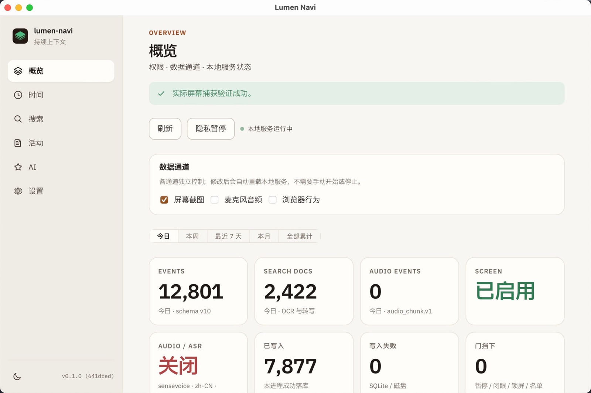
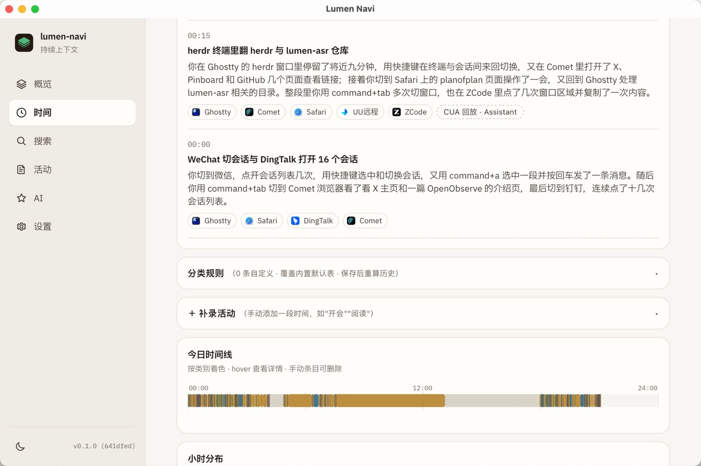

# Lumen Navi

[](https://github.com/fakechris/lumen-navi/releases)
[](https://github.com/fakechris/lumen-navi/actions/workflows/ci-windows.yml)
[](#安装)
[](LICENSE)

[English](README.md) | 中文

Local-first 的**连续上下文**。看着屏幕（可选加麦克风），数据留在你的机器上，把一天变成可搜索的时间线 —— 想的话还能跟它对话。

**仓库：** https://github.com/fakechris/lumen-navi

<p align="center">
  
</p>
<p align="center">
  
</p>

## 一句话

**持续看着重要的东西 —— 然后让这条数据流变得有用，而不发给任何托管服务。**

## 它做什么

| 面 | 你得到什么 |
|---------|----------------|
| **Observe（观察）** | 智能截屏（焦点 / 视觉变化 / 2 分钟活性覆盖）。可选麦克风 + 本地 ASR。硬闸门：暂停、闭眼、锁屏、应用黑名单。 |
| **Time（时间）** | 前台应用跟踪、闲置 vs 离开、15 分钟 History 卡片带 LLM 叙述、应用/场景排名、一天时间线。 |
| **Search（搜索）** | 设备上的 OCR + 转写全文检索，覆盖屏幕上出现过的内容。 |
| **AI** | 可选的本地 / OpenAI 兼容 Roast 与 Chat，基于当天的证据。⌥Space 快捷对话，结果可写回来源应用。 |
| **Act（行动，可选）** | 受门控的 CUA 回放与技能库。默认只走后台输入（不抢焦点），需通过四道投递门禁和停止线。MIT **cua-driver** 内嵌于 Lumen Cua.app，并以 `computer-use` MCP 提供给 Codex / Claude Code。绝不用于采集。 |
| **Storage（存储）** | 保留生命周期，加上整个数据目录的磁盘配额与分层清理（最旧媒体 → 旧元数据 → VACUUM）。近期历史保持可搜索。 |

所有数据都在 `~/Library/Application Support/LumenNavi/`（Windows：`%LOCALAPPDATA%\LumenNavi\`）。

## 架构

| 平面 | 角色 | 状态 |
|-------|------|--------|
| **Observe** | 多源接入 | 屏幕 + 麦克风已产品化；浏览器扩展可选 |
| **Memory** | 持久存储 + 异步处理 | SQLite + FTS + 任务（OCR / AX / ASR） |
| **Act** | 可选的计算机操作 | 通过内嵌的 MIT **cua-driver** 做受门控的回放（仅后台输入） |

完整阐述：[`docs/ARCHITECTURE.md`](docs/ARCHITECTURE.md) · 路线图：[`docs/PLAN.md`](docs/PLAN.md) · 采集政策：[`docs/OBSERVE_CAPTURE.md`](docs/OBSERVE_CAPTURE.md)

## 状态

| 领域 | 状态 |
|------|--------|
| 屏幕观察 + OCR | ✅ OCR 在隔离的 helper 进程中运行，失败有界重试（人工长跑未完） |
| 时间跟踪 + 15 分钟 History 卡片 | ✅ |
| 音频 + Observe ASR | ✅（默认 SenseVoice；可选 Whisper / Speech / Qwen HTTP） |
| 桌面应用（macOS） | ✅ 分区设置、登录项自启动、可配置快捷键 |
| 存储生命周期 | ✅ 保留策略 + 整个数据目录的磁盘配额 |
| Act（可选） | ✅ v1/v2：受门控回放、内嵌 cua-driver、终端交接 |
| Windows 10/11 x64 | ✅ 移植完成；硬件长跑待做 —— [`WINDOWS_PORT_STATUS.md`](docs/WINDOWS_PORT_STATUS.md) |
| Chrome 观察 | ✅ 实现完成；长跑待做 |
| 系统音频 | 后续 |

## 安装

最新版本：**v0.3.0**。从 **[GitHub Releases](https://github.com/fakechris/lumen-navi/releases/latest)** 下载（macOS arm64 / Intel DMG，Windows x64 NSIS）。变更见 [`CHANGELOG.md`](CHANGELOG.md)。

这些构建**未做 Apple 公证**。macOS 应用使用自签名证书签名，Windows 安装包未签名。这是预期行为。

### macOS

1. 把 **Lumen Navi** 拖进 `/Applications`。
2. 清除隔离标记 —— 否则 Gatekeeper 会说应用已损坏 / 无法验证：

```bash
xattr -d com.apple.quarantine "/Applications/Lumen Navi.app"
```

如果仍然拒绝（嵌套 helper 或目录级隔离）：

```bash
xattr -cr "/Applications/Lumen Navi.app"
```

3. **右键 → 打开**（第一次别双击）。Sequoia 上：系统设置 → 隐私与安全性 → 仍要打开。
4. 在应用里启动 Observe，这样它才能安装 **Lumen Cua** 并申请屏幕录制。如果 Cua 也被拦：

```bash
xattr -d com.apple.quarantine "/Applications/Lumen Cua.app"
```

校验和：DMG 旁边的 `SHA256SUMS.txt`。完整权限清单：[`docs/DESKTOP_RELEASE_NOTES.md`](docs/DESKTOP_RELEASE_NOTES.md)。

### Windows

SmartScreen：**更多信息 → 仍要运行**。按用户安装（`%LOCALAPPDATA%\Lumen Navi`），无需管理员。

## 仓库结构

```
lumen-navi/
├── crates/          # 守护进程 + 库
├── apps/desktop/    # Tauri 2 壳（macOS + Windows）
├── extensions/      # Chrome 浏览器观察 MVP
└── docs/
```

## 快速开始（从源码）

```bash
cargo test
# 桌面（macOS 上屏幕采集需要签名的 sidecar）：
bash scripts/macos/tauri-dev-signed.sh
# 或 release 形态的本地构建：
scripts/macos/build-desktop-release.sh aarch64-apple-darwin dmg
```

默认连续 ASR 是 **SenseVoice**（本地 sherpa-onnx）。模型放在**共享 Lumen 集群**路径
`~/Library/Application Support/Lumen/models/`（可用 `LUMEN_MODELS_DIR` / `asr.models_root` 覆盖）。
见 [`docs/AUDIO_PRODUCT.md`](docs/AUDIO_PRODUCT.md) 与 [`docs/DESKTOP.md`](docs/DESKTOP.md)。

```bash
# 守护进程运行时搜索
curl -s 'http://127.0.0.1:7420/v1/ocr/search?q=关键词&limit=5' | jq .
```

### 时间跟踪分类（规则，不是代码）

应用分类用**固定匹配引擎** + **可编辑的 JSON 规则**（调关键词无需重新构建）：

- 规范与用法：[`crates/lumen-store/rules/README.md`](crates/lumen-store/rules/README.md)
- 在线覆盖：`~/Library/Application Support/LumenNavi/rules/`

## 浏览器观察

Chrome MV3 扩展把受隐私门控的生命周期流记录进自己的本地 IndexedDB 归档，并可选地把一份传输副本同步进本地守护进程。页面内容保持纯元数据，除非主机在显式允许列表上。不采集 HTML、输入值、选区、剪贴板数据或 DOM 链接列表。

[`docs/BROWSER_CAPTURE.md`](docs/BROWSER_CAPTURE.md)

## 相关项目

| 项目 | 链接 | 关系 |
|---------|------|----------------|
| **Lumen ASR** | https://github.com/fakechris/lumen-asr | 独立的**语音听写**产品。只共享模式；**没有**合并。 |
| **lumen-suite** | https://github.com/fakechris/lumen-suite | 共享 ASR 引擎、模型契约、转写互换（git 依赖）。 |
| **cua-driver** | https://github.com/trycua/cua | 开源 **MIT** 计算机操作库，用于可选的 **Act**。绝不用于观察。 |

## 配置要点

| 键 | 默认值 |
|-----|---------|
| `capture.*` | 多显示器、probe、防抖、2 分钟活性 —— `docs/OBSERVE_CAPTURE.md` |
| `capture.idle_session_ms` | `300000`（5 分钟无 HID 输入 → 离开） |
| `audio.sample_rate` / `chunk_ms` | 16000 / 3000 |
| `asr.enabled` / `locale` | true / `zh-CN` |
| `ocr.enabled` | true |
| `api.bind` | `127.0.0.1:7420` |
| `sources.browser` | `false` |

**cua-driver 不用于采集/OCR/ASR。**

## 许可证

Lumen Navi 基于 [GNU General Public License v3.0 only](LICENSE) 授权。
